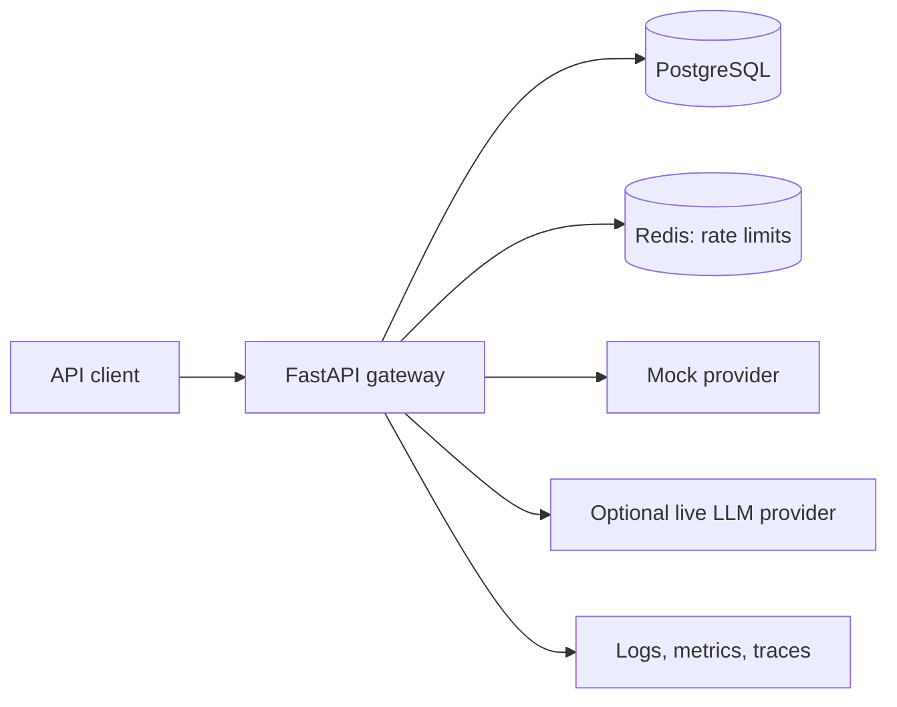

# Build an LLM Gateway While Revising Python and FastAPI

## 1. Goal and learning approach

Build a backend that lets applications access an LLM through a controlled API. It authenticates callers, validates requests, invokes a provider, streams responses, records usage, and handles failures.

**Timeline:** four weeks, 2–3 hours daily.  
**Workflow:** you implement small milestones; we review correctness, design, tests, and interview explanations.

Use your existing [Python revision index](/Users/soumanpaul/Desktop/Desk/interview/1.lang-dsa/language/Python/index.md) as the concept checklist. Learn concepts alongside the features that need them.

A typical session:

- **30 minutes:** revise the relevant Python/backend concepts.
- **75–110 minutes:** implement and test one behavior.
- **15–30 minutes:** document a decision and explain it aloud as an interview answer.

The deliverable is a working, tested local system with documented operational limits.

## 2. System and design

**Project name:** `llm-gateway`, in a separate repository under `/Users/soumanpaul/Desktop/Desk/projects/llm-gateway`.

**Stack:** Python 3.12, uv, FastAPI, Pydantic v2, HTTPX, SQLAlchemy 2, asyncpg, Alembic, PostgreSQL, Redis, pytest, Ruff, mypy, Docker Compose, and GitHub Actions.

**HLD:** one modular application. PostgreSQL stores durable records; Redis coordinates rate limits across API processes. Provider calls happen outside database transactions.

**LLD:** routers handle HTTP concerns; services coordinate use cases; persistence modules own queries; provider adapters implement a small typed interface for ordinary and streamed generation. Use composition and dependency injection where they support testing or replacing infrastructure.

Manage shared HTTP clients through application lifespan, and give independent database operations their own sessions. These practices follow the resource and concurrency guidance in [HTTPX](https://www.python-httpx.org/async/) and [SQLAlchemy](https://docs.sqlalchemy.org/en/20/orm/extensions/asyncio.html).

**Initial interfaces:**

| Interface | Purpose |
|---|---|
| Bootstrap CLI | Create projects and issue/revoke API keys |
| `GET /v1/models` | List configured model aliases |
| `POST /v1/generations` | Generate text; optionally return an SSE stream |
| `GET /v1/requests` | Cursor-paginated request metadata for the authenticated project |
| `GET /v1/usage` | Project usage totals for a bounded date range |
| `/health/live`, `/health/ready` | Process and dependency health |

The generation contract accepts a model alias, text messages, output-token limit, and streaming flag. Responses carry a request ID, generated text, finish reason, and usage when available. SSE uses documented `delta`, `completed`, and `error` events.

Use a project-owned API contract; full compatibility with an external SDK is outside this version.

## 3. Four-week build sequence

| Week | Working milestone | Python revision | Backend and design practice |
|---|---|---|---|
| **1: Request lifecycle** | Validated generation API calling a deterministic mock provider | Types, collections, functions, exceptions, modules, dataclasses, protocols, composition, context managers | HTTP semantics, schemas, dependency injection, configuration, error contracts, HLD and request sequence diagram |
| **2: Durable state and security** | Projects, API keys, request history, usage queries, migrations | Generators, enums, fixtures, mocking, resource ownership | Relational modeling, constraints, transactions, indexes, pagination, authentication and project isolation |
| **3: Async and resilience** | SSE streaming, Redis rate limits, bounded concurrency, timeouts and cancellation | Coroutines, tasks, async generators, semaphores, cancellation, threads versus processes | Connection pools, backpressure, failure mapping, distributed versus process-local limits, retry trade-offs |
| **4: Operations and interview evidence** | Compose environment, CI, metrics, traces, load report and runbook | Profiling, logging, memory behavior, targeted revision | Query analysis, load testing, dependency failures, graceful shutdown, deployment and scaling discussion |

Use five implementation days, one integration/review day, and one catch-up/mock-interview day each week.

Every milestone includes:

- A short feature brief and acceptance criteria before implementation.
- Tests alongside the feature.
- One architecture decision explaining alternatives and consequences.
- One debugging exercise and three interview questions.
- A link back to the relevant revision notes.

## 4. Required behavior and validation

**Security and persistence**

- Generate high-entropy API keys; show the secret once and store its digest.
- Derive project identity from authentication and enforce isolation on every query.
- Store request metadata and usage without logging prompts, responses, or credentials by default.
- Distinguish unknown usage after interrupted requests from confirmed zero usage.

**Concurrency and failures**

- Start with a configurable mock supporting delay, errors, and streamed chunks.
- Add one optional HTTP-based live provider adapter after the core tests pass.
- Configure connection/read deadlines and an overall request deadline.
- Cancel upstream work and release resources when the client disconnects.
- Use atomic Redis request limits and explicit process-local concurrency limits; document how limits change with multiple workers.
- Fail readiness and reject generation requests when required persistence or rate-limit dependencies are unavailable.
- Do not automatically replay ambiguous generation failures or restart partially delivered streams; explain the duplicate-work and cost risks.

**Acceptance tests**

- Validation errors, invalid/revoked keys, and cross-project access.
- Database migrations, rollback behavior, pagination, and usage aggregation.
- Provider timeouts, malformed responses, rate limits, and upstream failures.
- Concurrent rate-limit enforcement across two API processes.
- Stream interruption, cancellation, and connection cleanup.
- Redis/database outages and graceful shutdown.
- A repeatable mock-provider load test at 1, 10, and 50 concurrent clients, reporting throughput, latency, errors, and resource usage.

Measure behavior on your machine and document the findings before claiming performance targets.

## 5. Finish line and boundaries

By the end, you should be able to demonstrate the system and explain:

- A request’s path from authentication to provider response and usage recording.
- Why async helps this I/O-heavy workload and how blocking code harms it.
- Transaction boundaries, indexes, connection pools, and pagination choices.
- Streaming failure behavior, rate limiting, and concurrency limits.
- How you would investigate rising latency, exhausted connections, and provider outages.
- How the design would evolve toward multiple providers and durable background jobs.

Deliver the code, OpenAPI examples, HLD diagram, key LLD sequence diagrams, decision notes, CI checks, load-test report, and deployment/runbook documentation.

**Defaults:** mock-first development, optional live smoke tests, local Docker Compose, CLI administration, and backend foundations as the priority. Defer frontend work, RAG, model hosting, billing, durable job queues, automatic failover, Kubernetes, and microservices.
